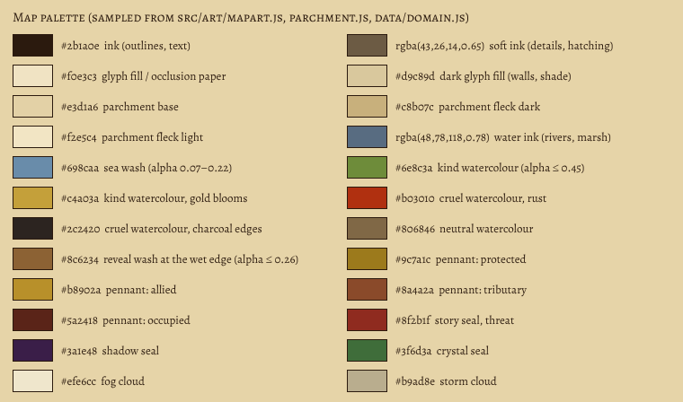

# Map art specification

For whoever draws replacement map symbols (an artist or an image model). Sizes per symbol: [CATALOG.md](CATALOG.md).
File format and manifest: [assets/map/README.md](../../assets/map/README.md). How to install: [REPLACING.md](REPLACING.md).

## Direction

A literary fantasy map on warm parchment: sepia ink, hand-drawn mountains and forests, small illustrated
settlements, restrained colour. Original imagery in the spirit of classic fantasy cartography (no copied Tolkien
geography or symbols). Not a pixel tile map: only moving actors (the dragon, optionally caravans) may be pixel art.
Kind rule brings subtle green and gold and flourishing growth; cruel rule brings muted rust, brown and charcoal,
burned forests and jagged mountains. Both stay on the parchment.

## Palette (sampled from the code)

| use | colour |
| --- | --- |
| ink: outlines | `#2b1a0e` |
| soft ink: hatching, small details | `rgba(43,26,14,0.65)` |
| symbol fill, occlusion paper | `#f0e3c3` |
| dark fill: walls, shade | `#d9c89d` |
| parchment (the map's paper; textured, flecks `#c8b07c` and `#f2e5c4`) | `#e3d1a6` |
| water ink: rivers, marsh strokes | `rgba(48,78,118,0.78)` |
| sea wash (alpha 0.07–0.22 by depth) | `#698caa` |
| territory watercolour (alpha ≤ 0.45), two colours per path mixed by the hue mask: kind, cruel, neutral | `#6e8c3a` + `#c4a03a`, `#b03010` + `#2c2420`, `#806846` + `#604a30` |
| reveal wash at the wet edge of newly uncovered land (at most 26% opacity) | `#8c6234` |
| pennants: protected, allied, tributary, occupied | `#9c7a1c`, `#b8902a`, `#8a4a2a`, `#5a2418` |
| seals: story and threat, shadow, crystal | `#8f2b1f`, `#3a1e48`, `#3f6d3a` |
| fog cloud, storm cloud | `#efe6cc`, `#b9ad8e` |

Keep colour inside the symbol modest: the washes, pennants and seals carry the political colour and must stay
readable on top of your art. Watercolour masks carry no colour at all (the engine tints them): [WASH.md](WASH.md).

## Ink thickness

At zoom 1 the hand-drawn symbols use strokes of 0.7–0.9 px for details, 1.0–1.2 px for outlines and 1.4–1.6 px for
heavy marks (mountain ridges). At the recommended 4× export that is **3–4 px detail, 4–5 px outline, 6 px heavy**.
In the far overview (zoom below 0.55) terrain is drawn at about half size: lines thinner than 3 px at 4× vanish
there.

## Transparency and occlusion

- Transparent RGBA PNG, no background, no paper texture, no drop shadow onto the paper.
- Symbols that should hide what is behind them (mountains, buildings) either get an opaque fill in `#f0e3c3` inside
  the outline (as the hand-drawn ones do), or stay transparent and ship an `occlusionMask` PNG of the same size
  whose opaque pixels are filled with paper colour underneath the art.
- Soft anti-aliased edges are fine; avoid semi-transparent haze around the symbol (it reads as a stain).

## Export resolution, padding and anchor

- Draw at **4× the catalog's recommended logical size** (places and markers are drawn at screen resolution, up to 2
  device pixels per screen pixel, and may be shown at 1.2×). Terrain is cached at 1× in map chunks and scaled with
  the map, so terrain above 2× gains nothing today; 4× is still fine and future-proof.
- Leave about 4 px (1 logical px) of transparent padding on every side. Padding is never cropped; it counts in
  `sourceSize` and `anchorPx`.
- Put the anchor where the catalog says: the centre of the base on the ground line for mountains, trees and places;
  the foot of the pole for pennants and banners; the centre for seals, swords, clouds and the compass.
- Terrain must stay within 2.2 cells of its anchor at its largest size (the catalog's `maxReachAtK1`, about 30 px at
  1× for a mountain); larger art is refused.
- Keep the procedural footprint: within about 15 % of the catalog's measured bounds, so density and spacing still
  read the same. More variants (2–4 per terrain symbol) look better than one.

## Content rules

- No text, names, numbers, selection rings, target marks or arrows in the art.
- No faction colours or flags on buildings: castles give an `attach.flag` point; armies use a `tintMask`.
- Burned and ruined states are separate files (`map.place.village.burned`); without them the engine overlays smoke on
  the normal art.
- Top-down-ish three-quarter view, light from the upper left (hatching on the right/lower faces), as the
  hand-drawn symbols do.

## Filenames

Lower case, hyphens, the scale as a suffix: `mountain-a@4x.png`, `village-burned@4x.png`, `pennant-allied@4x.png`.
Group by layer in sub-folders (`terrain/`, `places/`, `markers/`, `fog/`, `wash/`). Masks take the art's name with a
suffix: `mountain-a-mask@4x.png`. Filenames are free; the manifest's semantic id is what the
game uses.
